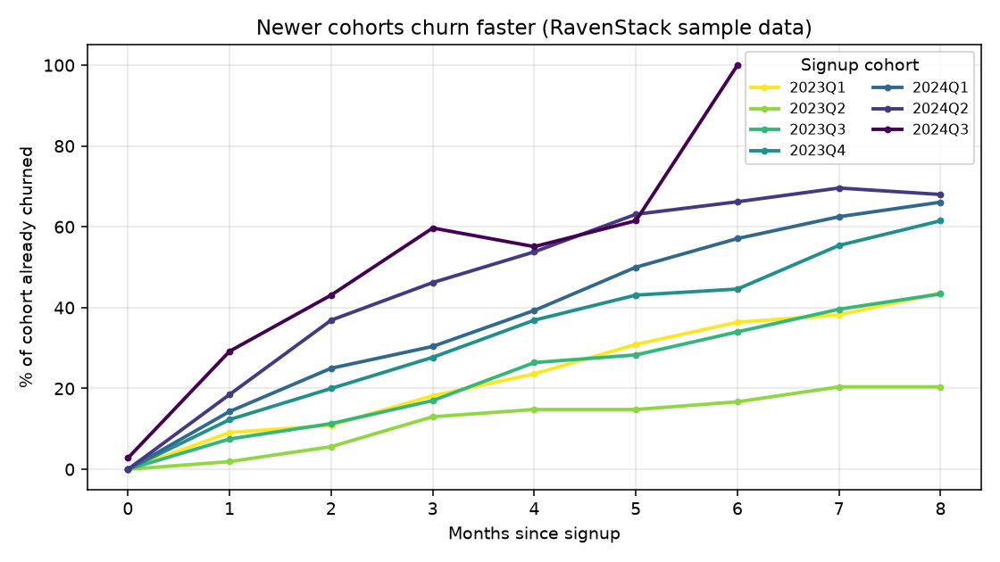

# Cohort Retention Monitor

[English](#english) | [Português](#português)

---

## English

A small Python script that shows **how fast each signup cohort churns**, and raises an alert when newer cohorts are churning much faster than older ones.

### Why cohorts instead of per-account risk scores

In a churn diagnosis of a SaaS dataset, no account attribute (industry, plan, channel, MRR, individual usage, satisfaction) separated customers who churned from those who stayed. What changed was **when** the account signed up. Looking at churn by signup cohort exposed a problem that aggregate churn counts hide: new customers were leaving much earlier than before.

Share of each cohort that had already churned N months after signup (excerpt from [`examples/curva_retencao_trimestral.csv`](examples/curva_retencao_trimestral.csv), generated by this script with `--cohort_freq Q`):

| Months since signup | 2023Q1 | 2023Q4 | 2024Q2 | 2024Q3 |
|---|---|---|---|---|
| 1 | 9.1% | 12.3% | 18.5% | 29.2% |
| 2 | 10.9% | 20.0% | 36.9% | 43.1% |
| 3 | 18.2% | 27.7% | 46.2% | 59.7% |



The 2024Q3 line jumps to 100% at month 6 because only a handful of its accounts are old enough to be observed that far; read the tail of recent cohorts with caution.

### Usage

```bash
pip install -r requirements.txt
python cohort_retention_monitor.py accounts.csv churn_events.csv --cutoff 2024-12-31
```

Options: `--cohort_freq` sets the cohort size as a pandas period frequency: `Q` (quarterly, recommended), `M` (monthly) or `Y` (yearly). The default value `2Q` also produces quarterly cohorts.

Input files need these columns: `accounts.csv` with `account_id`, `signup_date`; `churn_events.csv` with `account_id`, `churn_date`.

The output is a table of `% churned` by months since signup, per cohort. Points that cannot be observed yet (cohort too young for that month) are left empty instead of being treated as zero. An alert is printed when the churn at month 2 of the newest cohort is at least 3x the oldest cohort's.

### Statistical version with lifelines

[`examples/km_by_signup_cohort.py`](examples/km_by_signup_cohort.py) compares cohorts with Kaplan-Meier curves and a log-rank test on synthetic data, using the [lifelines](https://github.com/CamDavidsonPilon/lifelines) library: `uv run --with lifelines --with matplotlib python examples/km_by_signup_cohort.py`.

### Data

The example numbers come from the public Kaggle dataset [SaaS Subscription & Churn Analytics](https://www.kaggle.com/datasets/rivalytics/saas-subscription-and-churn-analytics-dataset) (MIT license, synthetic data). The raw dataset is not included here: download it from Kaggle.

### Limitations

- The example dataset is synthetic and ends on 2024-12-31, so the most recent cohort has few accounts and a noisier curve.
- The alert is a heuristic (default factor 3x), not a statistical test. Tune `fator_alerta` to your business.
- A cohort curve shows *that* newer customers churn faster, not *why*. Causes need operational data (onboarding, support, pricing changes).

---

## Português

Script em Python que mostra **com que velocidade cada cohort de signup dá churn** e dispara um alerta quando cohorts novas estão saindo muito mais rápido que as antigas.

### Por que cohort e não score de risco por conta

Num diagnóstico de churn de uma base SaaS, nenhum atributo da conta (indústria, plano, canal, MRR, uso individual, satisfação) separava quem saiu de quem ficou. O que mudou foi **quando** a conta entrou. Olhar o churn por cohort de signup expôs um problema que a contagem agregada de churn esconde: clientes novos estavam saindo muito mais cedo que antes. A tabela e o gráfico acima (em inglês) mostram o percentual de cada cohort que já tinha dado churn N meses após o signup.

### Uso

```bash
pip install -r requirements.txt
python cohort_retention_monitor.py accounts.csv churn_events.csv --cutoff 2024-12-31
```

Opções: `--cohort_freq` define o tamanho da cohort como frequência de período do pandas: `Q` (trimestral, recomendado), `M` (mensal) ou `Y` (anual). O valor padrão `2Q` também gera cohorts trimestrais.

Colunas necessárias: `accounts.csv` com `account_id`, `signup_date`; `churn_events.csv` com `account_id`, `churn_date`.

A saída é uma tabela de `% churned` por meses desde o signup, por cohort. Pontos ainda não observáveis (cohort muito jovem) ficam vazios, não zerados. O alerta aparece quando o churn no mês 2 da cohort mais recente é pelo menos 3x o da mais antiga.

### Versão estatística com lifelines

[`examples/km_by_signup_cohort.py`](examples/km_by_signup_cohort.py) compara as cohorts com curvas de Kaplan-Meier e teste log-rank em dados sintéticos, usando a biblioteca [lifelines](https://github.com/CamDavidsonPilon/lifelines).

### Dados

Os números de exemplo vêm do dataset público do Kaggle [SaaS Subscription & Churn Analytics](https://www.kaggle.com/datasets/rivalytics/saas-subscription-and-churn-analytics-dataset) (licença MIT, dados sintéticos). Os dados brutos não estão neste repositório: baixe no Kaggle.

### Limitações

- O dataset de exemplo é sintético e termina em 2024-12-31, então a cohort mais recente tem poucas contas e uma curva mais ruidosa.
- O alerta é uma heurística (fator padrão 3x), não um teste estatístico. Ajuste `fator_alerta` ao seu negócio.
- A curva mostra *que* clientes novos saem mais rápido, não *por quê*. As causas exigem dados operacionais (onboarding, suporte, mudanças de preço).

---

MIT License. Author: Renan Vieira.
